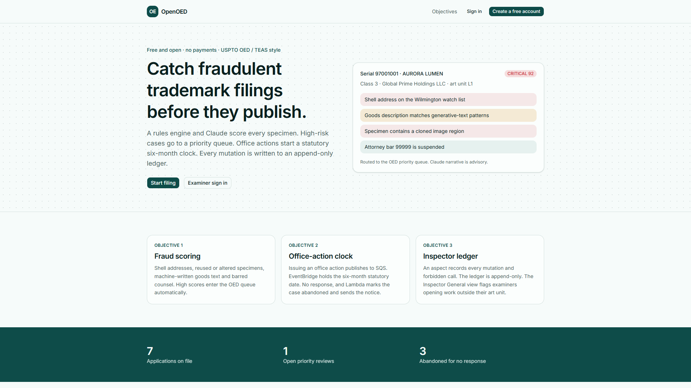

# OpenOED — trademark fraud detection and office-action deadlines

A free, open, SaaS-style workbench (no payments, no tiers) modelled on the USPTO's fraud and prosecution problem —
**OED** review of suspicious trademark filings and the statutory **office-action** clock. Examiners, applicants,
OED analysts and the Inspector General sign up and use one system built on Spring Boot, Angular and PostgreSQL.
Everything runs locally. Every component is shaped to map 1:1 onto AWS (Aurora PostgreSQL, SQS, EventBridge
Scheduler, Lambda, SES, DynamoDB).

[](docs/demo/openoed-demo.mp4)

▶️ **[Watch the demo](docs/demo/openoed-demo.mp4)** — the OED priority queue, a critical Aurora Lumen score
(shell address, machine-written goods, stripped specimen metadata, suspended counsel), an examiner opening a
filing outside their art unit, the six-month office-action clock firing into an abandonment notice, and the
append-only Inspector General ledger.
(1920×1080 · 30 fps · 8 Mbps H.264 + AAC voice-over · BT.709 · 60 s; recorded with
[`docs/demo/record-demo.mjs`](docs/demo/record-demo.mjs) and encoded by [`docs/demo/encode.ps1`](docs/demo/encode.ps1).)

| Objective | How it is built | Where |
|---|---|---|
| **AI-powered trademark fraud detection** — a new filing is scored by a rules engine and, when a key is set, by Claude. High scores land on a priority manual-review queue | Pure-Java rules: shell-address watch list, filing velocity, specimen SHA-256 reuse, JPEG blockiness, cloned 16×16 blocks, flat overlays, missing EXIF, generative-text phrases, class/goods mismatch, famous-mark lookalikes, barred counsel. Score 0–100 (HIGH ≥ 50, CRITICAL ≥ 75) stored on the application and in `risk_assessment`. Optional Claude narrative via the Anthropic Messages API | `fraud-engine`, `oed-api`, `web` |
| **Event-driven office-action deadlines** — issuing an office action publishes an event; a 6-month timer abandons the case if nobody responds | The API writes an outbox row in the same transaction. A relay publishes to SQS queue `office-actions`. The platform bridge creates an EventBridge Scheduler one-shot. When it fires, `deadline-lambda` calls the API: no response → status Abandoned, then SES sends the final notice. A response cancels the schedule. Dev profile can fire the timer immediately | `deadline-lambda`, `platform`, `oed-api`, `web` |
| **Zero-trust audit ledger** — every mutation and forbidden call is captured and kept append-only | An AspectJ interceptor on `@Audited` controller methods. Items go to a DynamoDB-shaped ledger (`pk` + `sk`, put-if-absent). Delete returns 405. If the ledger is down, the same JSON waits in `audit_outbox`. The Inspector General view flags `ART_UNIT_MISMATCH` when an examiner opens a filing outside their art unit | `oed-api` audit aspect, `platform` ledger, `web` `/app/inspector` |

```
browser (Angular 22 + ZardUI + Tailwind 4, :4206)
   │ /api (dev proxy)
   ▼
oed-api :8087 (Spring Boot 4) ──► PostgreSQL 18 :5433  (schema oed)
   │  fraud-engine (rules)  ·  optional Claude
   │  audit aspect ──► platform DynamoDB ledger
   │  office action ──► SQS office-actions
   ▼
platform :8090  SQS · EventBridge Scheduler · Lambda invoke · SES · append-only ledger
   └── deadline-lambda  (plain Java handler: abandon + final notice)
```

API / DB / event contract: [docs/CONTRACTS.md](docs/CONTRACTS.md) · AWS target: [docs/AWS.md](docs/AWS.md).

## Run it

Prerequisite: the portable toolchain in `D:\JavaSpring\tools` (JDK 21, Node 24, PostgreSQL 18).

```powershell
.\dev.ps1 up          # Postgres + platform + oed-api + Angular, each in its own window
.\dev.ps1 down        # stops those processes. Postgres stays up so the other projects keep their database
```

- Web: http://localhost:4206 — create a free applicant account, or use the dev personas:
  `oed@openoed.local` / `Oed#12345`, `examiner@openoed.local` / `Examiner#12345` (art unit L2),
  `applicant@openoed.local` / `Applicant#12345`, `ig@openoed.local` / `Inspector#12345`,
  `admin@openoed.local` / `Admin#12345`.
- API docs: http://localhost:8087/swagger-ui.html · platform status: http://localhost:8090/status
- Open **Aurora Lumen** (critical) and **NIKEO** (critical). **Harbor Soap** shows an abandoned case and its SES notice
  after the deadline is fired. Examiners are in art unit L2; a class 1–15 filing is L1, so opening it is an anomaly.

**Claude** is optional. Put `ANTHROPIC_API_KEY` in a git-ignored `.env` next to `dev.ps1` (see [`.env.example`](.env.example)).
Without a key every filing is still scored by the rules engine and the narrative status is `DISABLED`.

The statutory due date is always six months. The local scheduler fires sooner (`PT30M` in the dev profile) and the
**Fire deadline** button runs the Lambda path immediately.

## Build & test

```powershell
.\dev.ps1 build
```

| Module | Tests | Notes |
|---|---|---|
| `fraud-engine` | 22 · line gate 90% | every rule, image forensics, famous-mark and class mismatch |
| `deadline-lambda` | 5 · line gate 90% | abandon sends one notice; a response or a second fire does not |
| `platform` | 5 | SQS receive/delete, scheduler due-set, append-only ledger including HTTP 405 on delete |
| `oed-api` | 5 · service line gate 80% | Mockito on review and abandonment; full MockMvc flow on `openoed_test` (register, score, office action, response, abandon, notice, audit) |
| `web` | 2 (Vitest) | risk badge class and anomaly flag |

## AWS mapping (reference only — nothing is deployed)

| Local | AWS |
|---|---|
| oed-api | ECS Fargate behind an ALB |
| PostgreSQL 18 | Aurora PostgreSQL |
| platform SQS / schedules / SES / ledger | SQS, EventBridge Scheduler, SES, DynamoDB (deny update and delete) |
| deadline-lambda | Lambda Java 21 |
| web `dist/` | S3 + CloudFront |

## Layout

```
fraud-engine/       plain Java rules + specimen forensics
deadline-lambda/    plain Java abandonment handler
platform/           local SQS, EventBridge Scheduler, Lambda runtime, SES, append-only ledger
oed-api/            Spring Boot 4 · JWT · filings · reviews · office actions · audit aspect · Flyway
web/                Angular 22 · ZardUI · Tailwind 4 · Vitest
docs/demo/          landing.png, openoed-demo.mp4, recorder and encoder
docs/CONTRACTS.md   API / DB / event contract
docs/AWS.md         AWS mapping
dev.ps1             local runner
```
